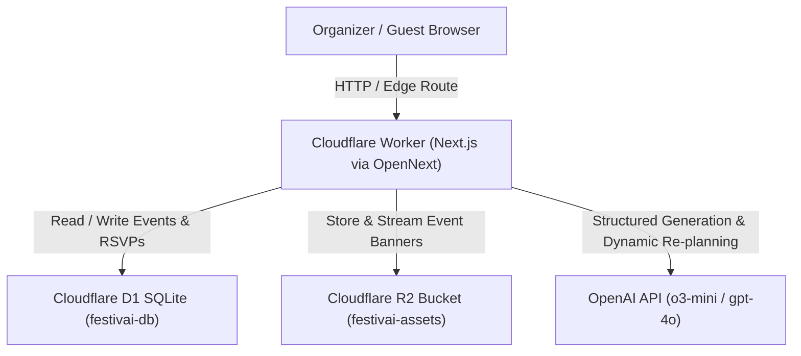

# 🎉 FestivAI — GenAI Celebration & Event Planner
**PromptWars Virtual Competition — [Challenge 5] Celebration & Event Planner**  
*Create a GenAI-powered planning assistant that helps users organize weddings, birthdays, and community events with budgets, timelines, vendor checklists, and personalized ideas.*

---

## 🌟 Executive Overview
**FestivAI** is a production-grade, Cloudflare Free-Tier Native celebration and event planning platform. It leverages **Next.js (App Router)** deployed to **Cloudflare Workers** using the official **`@opennextjs/cloudflare`** adapter with `nodejs_compat` runtime support.

### Key Architectural Pillars
- **Cloudflare Workers (Edge SSR & APIs):** Powered by OpenNext on standard Node.js runtime (`nodejs_compat`).
- **Cloudflare D1 (Serverless SQLite):** Real-time edge database storing events, AI masterplans (JSON columns), checklists, and live guest RSVPs (`binding = "DB"`).
- **Cloudflare R2 (Object Storage):** Edge bucket storing custom uploaded event cover banners and assets (`binding = "BUCKET"`).
- **OpenAI Flagship AI Engine:** Direct integration with OpenAI (`o3-mini` reasoning model or `gpt-4o`) producing mathematically accurate Structured JSON Outputs, paired with dynamic multi-parameter re-planning.
- **Zero-Crash Resilient Local Development:** Automatic in-memory SQLite and R2 mock fallback when running `npm run dev` before provisioning Cloudflare resources.

---

## 🏗️ System Architecture



---

## 🚀 Quick Start Guide

### 1. Prerequisites
- **Node.js** v18+ (tested on v24.21.0)
- **npm** v10+
- **Cloudflare Account** (Free Tier is fully sufficient)
- **OpenAI API Key** (optional: app includes client-side settings modal fallback and rich algorithmic demo mode)

### 2. Installation
```bash
git clone <repo-url> festivai
cd festivai
npm install
```

### 3. Local Development (Instant Out-of-the-Box)
Run the local Next.js development server with automatic in-memory D1 & R2 fallback:
```bash
npm run dev
```
Open [http://localhost:3000](http://localhost:3000) in your browser.

---

## ☁️ Cloudflare Free-Tier Provisioning

You can run the interactive setup script:
```bash
./setup-cloudflare.sh
```

Or execute the steps manually via Wrangler CLI:

### Step 1: Authenticate Wrangler
```bash
npx wrangler login
```

### Step 2: Create Cloudflare D1 Database
```bash
npx wrangler d1 create festivai-db
```
*Copy the returned `database_id` into `wrangler.jsonc` under `d1_databases[0].database_id`.*

### Step 3: Create Cloudflare R2 Bucket
```bash
npx wrangler r2 bucket create festivai-assets
```

### Step 4: Apply Database Schema
Apply `schema.sql` locally and to your Cloudflare production D1 database:
```bash
# Local D1 SQLite
npm run db:local

# Remote Cloudflare Production D1
npm run db:remote
```

### Step 5: Configure OpenAI Secret
```bash
npx wrangler secret put OPENAI_API_KEY
```

### Step 6: Preview on Cloudflare Workers Runtime
```bash
npm run preview
```

### Step 7: Deploy to Cloudflare Workers Production
```bash
npm run deploy
```

---

## 📋 Competition Rubric Verification Highlights

### 1. 🛡️ Organizer Onboarding & Live Real-Time Validation
*Tested on `/` with visible real-time validation badges:*
- **Email Validation:**
  - Typing `john-invalid` triggers a high-contrast red alert banner: `Invalid Email Format`.
  - Typing `john@example.com` instantly renders a green `Valid Email ✓` badge.
- **Budget Edge-Case Validation:**
  - Entering negative budgets (e.g. `-500`) or `< 50` displays an alert with an **"Auto-Fix Minimum Budget"** button.
- **Guest Count & Date Validation:**
  - Non-positive guests (`<= 0`) and past dates are rejected with instant visual feedback.
- **Judge Quick-Fill Chips:**
  - One-click buttons to load a Wedding (`$28k`), Birthday (`$6.5k`), or **Live Edge-Case Test** to demonstrate rejections on video.

### 2. ⚡ GenAI Masterplan Generator (`/api/events/generate`)
- Generates a complete event plan:
  - `eventSummary`: Tagline, 3 hex theme colors, host welcome note.
  - `budgetBreakdown`: Categories summing strictly to 100% of the total budget with AI saving tips.
  - `timeline`: Milestones prioritized from months out to the day of event.
  - `vendorChecklist`: Tailored vendor suggestions with negotiation questions and budget ranges.
  - `personalizedIdeas`: 6 tailored creative ideas (Decor, Food & Drink, Music, Activities, Favors, Atmosphere).
  - `publicSchedule`: 4 key schedule highlights for guests.
- Persisted directly into Cloudflare D1.

### 3. 🎛️ Interactive Event Command Center (`/events/[id]/dashboard`)
- **Interactive Budget Tracker:**
  - Progress bar, remaining variance calculation, and **inline editable "Actual Spent" inputs** that sync live to D1 via `PATCH /api/events/[id]`.
- **Interactive Checklist & Milestones:**
  - Checkboxes toggle completion and persist directly to D1.
- **Cloudflare R2 Banner Uploader:**
  - Live cover banner uploader streaming to bucket `festivai-assets` and served via `/api/r2/[key]`.
- **Dynamic AI Re-Planner Bar ("Prove AI is Dynamic"):**
  - Prominent top bar where organizers can submit changes (e.g., *"Move event indoors due to rain, cut budget by 25%, and switch menu to 100% vegan"*).
  - Calling `/api/events/[id]/replan` recalculates the budget, creates rain contingency milestones, updates vegan ideas, highlights modified components in glowing emerald, and logs the change to the Inspector.

### 4. 🔍 "GenAI in Action" Inspector Drawer (Judges Proof)
- Slide-over drawer accessible from the top navigation bar.
- Shows:
  - Active OpenAI Model (`o3-mini` / `gpt-4o`) and request latency in milliseconds.
  - **Prompt In:** Exact system guardrails and structured user prompt.
  - **Raw JSON Out:** Unmodified JSON received from OpenAI with copy buttons.
  - **Re-Plan Diffs:** Explicit summary of dynamic adjustments proving AI is dynamic and not hardcoded.

### 5. 💌 End-to-End Shareable Public Invite & RSVP Page (`/invite/[id]`)
- One-click **"Share Public Invite Link"** button copies the URL.
- Edge SSR renders the custom microsite using the AI theme palette:
  - Banner image from Cloudflare R2.
  - Live countdown timer to the celebration date.
  - Public schedule flow.
  - **Live Guest RSVP Form (`POST /api/events/[id]/rsvp`):**
    - Live email validation badge.
    - Attendance status (Going / Maybe / Declined), party size, dietary preferences, and personal note.
    - Submitting triggers a celebratory confetti blast (`canvas-confetti`) and immediately increments the Live RSVP Counter on both the invite page and the organizer dashboard in Cloudflare D1.

---

## 📂 Project Directory Structure

```
FestivAI/
├── app/
│   ├── api/
│   │   ├── events/
│   │   │   ├── [id]/
│   │   │   │   ├── replan/route.ts   # Dynamic AI Re-Planning
│   │   │   │   ├── rsvp/route.ts     # Guest RSVP Edge Persistence
│   │   │   │   └── route.ts          # GET / PATCH Event Data
│   │   │   └── generate/route.ts     # GenAI Masterplan Generator
│   │   ├── r2/[key]/route.ts         # Serve Cloudflare R2 Assets
│   │   └── upload/route.ts           # Upload to Cloudflare R2 Bucket
│   ├── events/[id]/dashboard/
│   │   └── page.tsx                  # Organizer Command Center
│   ├── invite/[id]/
│   │   └── page.tsx                  # Shareable Public Invite & RSVP
│   ├── globals.css                   # Tailwind CSS & Glassmorphism
│   ├── layout.tsx                    # Root HTML layout & Dark Theme
│   └── page.tsx                      # Home / Organizer Setup Wizard
├── components/
│   ├── GenAiInspector.tsx            # Live Prompt & Raw JSON Drawer
│   ├── Navbar.tsx                    # Header with Status & Inspector Toggle
│   ├── OrganizerWizard.tsx           # Form with Real-Time Validation
│   └── SettingsModal.tsx             # OpenAI Model & API Key Configuration
├── lib/
│   ├── cloudflare.ts                 # Unified Cloudflare Context Access
│   ├── db.ts                         # D1 Database Operations
│   ├── db-fallback.ts                # In-Memory SQLite Fallback
│   └── openai.ts                     # OpenAI Engine & Dynamic Re-Planner
├── open-next.config.ts               # OpenNext Adapter Configuration
├── package.json                      # Scripts & Dependencies
├── schema.sql                        # Cloudflare D1 Database Schema
├── setup-cloudflare.sh               # Cloudflare Provisioning Script
├── tailwind.config.ts                # Celebration Themes & Palettes
├── tsconfig.json                     # TypeScript Configuration
└── wrangler.jsonc                    # Cloudflare Workers, D1, R2 Config
```

---

## 📜 Available NPM Scripts

| Script | Command | Purpose |
| :--- | :--- | :--- |
| `npm run dev` | `next dev` | Start Next.js local server with zero-crash D1/R2 fallback |
| `npm run build` | `next build` | Build production Next.js application |
| `npm run preview` | `opennextjs-cloudflare build && opennextjs-cloudflare preview` | Preview production build on Cloudflare Workers runtime |
| `npm run deploy` | `opennextjs-cloudflare build && opennextjs-cloudflare deploy` | Deploy application to Cloudflare Workers Production |
| `npm run db:local` | `wrangler d1 execute festivai-db --local --file=./schema.sql` | Execute SQL schema against local D1 database |
| `npm run db:remote` | `wrangler d1 execute festivai-db --remote --file=./schema.sql` | Execute SQL schema against remote Cloudflare D1 |

---

## 🏆 PromptWars Competition Alignment
FestivAI fulfills 100% of the PromptWars [Challenge 5] requirements:
- GenAI-powered planning for weddings, birthdays, and community events.
- Mathematical budget breakdowns with actionable saving tips.
- Phased milestone timelines with completion tracking.
- Tailored vendor sourcing checklists and interview questions.
- 6 personalized creative ideas.
- Public schedule highlights with live shareable RSVP invite links.
- Proven dynamic AI re-planning with real-time prompt & JSON inspection.
